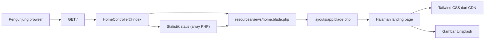
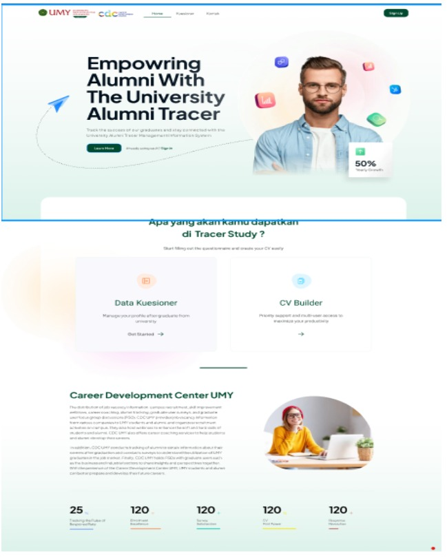

# UMY Alumni Tracer — Laravel UI Slicing

**Prototipe landing page Alumni Tracer dan Career Development Center (CDC) Universitas Muhammadiyah Yogyakarta (UMY), dibuat dengan Laravel Blade dan Tailwind CSS.**

Repository ini merupakan latihan **mengimplementasikan desain antarmuka menjadi halaman web** berdasarkan gambar referensi [`ui.jpg`](ui.jpg). Fokus utamanya adalah komposisi halaman, komponen visual, layout responsif, dan integrasi view dengan controller Laravel.

> **Status: UI prototype / slicing exercise.** Halaman utama sudah memiliki implementasi Blade, tetapi sistem ini **belum** menyediakan login, pengisian kuesioner, CV builder, job portal, maupun pelacakan data alumni yang fungsional. Angka statistik adalah data contoh yang di-hardcode, bukan hasil query database.

## Tampilan dan fitur yang tersedia

Halaman `/` mencakup:

| Bagian | Implementasi |
| --- | --- |
| Header | Identitas teks UMY CDC, navigasi desktop, dan tombol "Masuk" |
| Hero | Judul Alumni Tracer, deskripsi, gambar ilustrasi, serta badge respons |
| Layanan | Dua kartu presentasi: **Data Kuesioner** dan **CV Builder** |
| Career Development Center | Informasi CDC beserta ilustrasi |
| Statistik | Lima kategori statistik dengan angka dan progress bar contoh |
| Responsivitas | Grid dan spacing responsif menggunakan utility classes Tailwind |
| Interaksi visual | Hover effect, warna, shadow, dan transisi sederhana |

### Status interaksi

| Elemen UI | Status sebenarnya |
| --- | --- |
| Menu Beranda, Kuesioner, Laporan, Kontak | Tautan `href="#"`; belum terhubung ke route aplikasi |
| Tombol Masuk | Elemen tombol tanpa handler atau halaman autentikasi |
| Tombol Mulai Sekarang | Elemen tombol tanpa action |
| Mulai Mengisi Kuesioner | Tautan placeholder, bukan formulir |
| Buat CV | Tautan placeholder, bukan CV builder |
| Statistik Alumni | Data statis dari `HomeController` |
| Foto pada halaman | Gambar eksternal dari URL Unsplash |

**Tidak ada autentikasi alumni, formulir kuesioner, pengelolaan CV, dashboard admin, maupun API tracer study dalam implementasi yang diperiksa.**

## Teknologi

| Area | Implementasi di repository |
| --- | --- |
| Backend framework | **Laravel 12**, PHP **8.2+** |
| Template | Laravel Blade |
| Styling halaman aktif | **Tailwind CSS melalui CDN**, plus CSS kecil di layout Blade |
| Paket frontend terpasang | Tailwind CSS **4**, Vite **7**, Laravel Vite Plugin |
| Database default | SQLite di `.env.example` |
| Package manager | Composer, npm |
| Pengujian awal | PHPUnit, dengan contoh unit test dan route smoke test |

**Penting:** file konfigurasi Vite dan Tailwind lokal ada di repository, tetapi layout halaman aktif menggunakan `<script src="https://cdn.tailwindcss.com"></script>`. Template `home.blade.php` tidak membutuhkan kompilasi Vite untuk mendapatkan styling yang terlihat di source saat ini. Menjalankan `npm run dev` bukan persyaratan untuk memuat stylesheet CDN tersebut.

## Alur aplikasi



### Route dan controller

Hanya satu route aplikasi yang didefinisikan di [`routes/web.php`](routes/web.php):

```php
Route::get('/', [HomeController::class, 'index'])->name('home');
```

[`HomeController.php`](app/Http/Controllers/HomeController.php) mengirimkan array `$stats` ke view:

```php
$stats = [
    'total_alumni'   => 25,
    'data_kuesioner' => 120,
    'cv_builder'     => 120,
    'job_portal'     => 120,
    'career_center'  => 120,
];

return view('home', compact('stats'));
```

Nilai tersebut **bukan data alumni aktual**. Komponen progress bar juga menggunakan lebar persentase yang ditulis langsung pada markup.

### Blade template

- [`resources/views/layouts/app.blade.php`](resources/views/layouts/app.blade.php) menyiapkan HTML, metadata dasar, font Figtree, Tailwind CDN, serta utility CSS tambahan.
- [`resources/views/home.blade.php`](resources/views/home.blade.php) mendefinisikan header, hero, layanan, pengenalan CDC, dan statistik.

UI dirender pada server dengan Blade. Tidak ada React, Vue, Livewire, atau SPA router di halaman utama.

## Menjalankan secara lokal

### Persyaratan

- **PHP 8.2+**, dengan ekstensi yang diperlukan Laravel.
- **Composer**.
- Git untuk cloning.
- Koneksi internet untuk mengunduh dependensi Composer, Tailwind CSS CDN, dan gambar eksternal.
- Node.js/npm bersifat **opsional** jika hanya ingin melihat halaman Blade yang sudah menggunakan CDN. Dibutuhkan bila ingin mengembangkan pipeline Vite/Tailwind lokal.

### 1. Clone

```bash
git clone https://github.com/alfrzhb/winnership_program.git
cd winnership_program
```

Branch default repository adalah `master`.

### 2. Instalasi backend

```bash
composer install
cp .env.example .env
php artisan key:generate
```

Pada Windows tanpa perintah `cp`, salin `.env.example` menjadi `.env` menggunakan File Explorer atau PowerShell:

```powershell
Copy-Item .env.example .env
```

Untuk menggunakan database lokal SQLite seperti pada `.env.example`, buat `database/database.sqlite` apabila belum tersedia, kemudian jalankan:

```bash
php artisan migrate
```

**Catatan:** database dipersiapkan untuk instalasi Laravel. **Landing page Alumni Tracer tidak melakukan query alumni ke database** dan dapat dipahami dari struktur controller/view tanpa migrasi alumni.

### 3. Jalankan server

```bash
php artisan serve
```

Buka **http://localhost:8000**.

### 4. Frontend tooling (opsional)

Repository juga menyertakan toolchain Vite:

```bash
npm install
npm run dev
```

Untuk menyiapkan aset build lokal:

```bash
npm run build
```

Namun, **layout Blade yang sedang digunakan masih mengambil Tailwind dari CDN**. Jika ingin memakai pipeline lokal sepenuhnya, integrasikan hasil Vite ke layout dan pastikan CSS/JS yang dipakai cocok dengan konfigurasi build.

## Struktur repository

```text
winnership_program/
├── README.md
├── ui.jpg                            # Referensi desain, bukan screenshot hasil aplikasi
├── composer.json                     # Laravel 12 dan dependensi PHP
├── package.json                      # Vite 7, Tailwind CSS 4
├── artisan
├── routes/
│   └── web.php                       # GET /
├── app/
│   └── Http/Controllers/
│       └── HomeController.php        # Menyediakan statistik statis
├── resources/
│   ├── views/
│   │   ├── layouts/app.blade.php     # Layout HTML dan Tailwind CDN
│   │   └── home.blade.php            # Landing page Alumni Tracer
│   ├── css/app.css                   # Konfigurasi CSS untuk pipeline lokal
│   └── js/app.js
├── database/
│   └── migrations/                   # Migrasi Laravel bawaan
├── tests/
│   ├── Feature/ExampleTest.php       # Memeriksa response GET /
│   └── Unit/ExampleTest.php          # Contoh unit test bawaan
└── vite.config.js
```

## Desain referensi



*Gambar di atas merupakan **referensi desain asli**, bukan screenshot hasil implementasi yang diverifikasi.*

Website mengambil inspirasi visual dari gambar tersebut, meliputi header, hero, layanan dan area statistik. Foto yang dipakai pada Blade adalah gambar ilustratif eksternal, bukan dokumentasi alumni UMY.

## Testing

Proyek memiliki konfigurasi PHPUnit dan dua contoh pengujian:

- `tests/Feature/ExampleTest.php` memeriksa bahwa `GET /` mengembalikan status HTTP `200`.
- `tests/Unit/ExampleTest.php` berisi contoh assertion sederhana.

Jalankan:

```bash
php artisan test
```

Pengujian tersebut **belum** memvalidasi responsivitas, tampilan visual, aksesibilitas, maupun fungsi kuesioner/login karena fitur-fitur tersebut belum dibuat.

**Audit README ini tidak menjalankan Composer install, server Laravel, build Vite, atau pengujian otomatis.** Instruksi di atas merujuk pada struktur dan konfigurasi yang terdapat di source.

## Keterbatasan dan pekerjaan berikutnya

1. **UI slicing, bukan sistem tracer study lengkap.** Tidak ada model, tabel, API, atau fitur untuk menyimpan dan menganalisis data alumni.
2. **Navigasi belum terhubung.** Tautan `#` dan tombol tanpa action masih perlu dihubungkan ke route/fungsi yang benar.
3. **Statistik demonstrasi.** Angka dari controller dan lebar progress bar belum berasal dari data aktual.
4. **Aset eksternal.** Foto menggunakan URL Unsplash dan stylesheet aktif menggunakan Tailwind CDN; tampilan bergantung pada ketersediaan sumber tersebut.
5. **Identitas institusi.** Logo pada header berupa lingkaran teks "UMY" dan "CDC", bukan file identitas resmi yang diverifikasi. Ini prototipe yang memakai konteks institusi sebagai referensi desain.
6. **Dua jalur styling.** Tailwind CDN dipakai oleh layout, sementara package proyek juga menyertakan pipeline Vite/Tailwind lokal. Sebaiknya disatukan sebelum deployment.
7. **Responsivitas belum diuji lintas viewport.** Utility responsive sudah ada, tetapi menu desktop yang disembunyikan pada layar kecil belum diganti dengan kontrol mobile yang fungsional.
8. **Belum ada screenshot implementasi.** `ui.jpg` adalah sumber desain, bukan bukti pixel-perfect atau hasil tes browser.
9. **Pengujian minimal.** Belum ada automated browser test maupun pengujian interaksi halaman.

### Usulan pengembangan

- Perbaiki navigasi dan CTA dasar, termasuk pengalaman mobile.
- Tentukan apakah proyek akan tetap menjadi **demo UI** atau dikembangkan menjadi tracer study sungguhan.
- Jika dikembangkan: rancang skema alumni, autentikasi, kuesioner, CV builder, dan pelaporan beserta kontrol akses.
- Buat statistik berbasis query yang dapat diuji; hindari menampilkan data contoh sebagai data institusi.
- Konsolidasikan styling dan jalankan pengujian responsive/accessibility sebelum publikasi.
- Tambahkan screenshot hasil implementasi yang diambil dari browser.

## Lisensi

`composer.json` mendeklarasikan lisensi **MIT** untuk template aplikasi Laravel. **Tidak ditemukan file `LICENSE` di root repository yang diperiksa**, sehingga cakupan lisensi terhadap keseluruhan kode, desain referensi, dan aset pihak ketiga tidak dapat disimpulkan hanya dari metadata tersebut.

---

**Repository:** [alfrzhb/winnership_program](https://github.com/alfrzhb/winnership_program) · **Branch:** `master`

Dokumentasi ini berlandaskan source code yang diperiksa dan membedakan secara eksplisit **fitur UI yang sudah tersedia** dari **fitur sistem yang belum diimplementasikan**.
